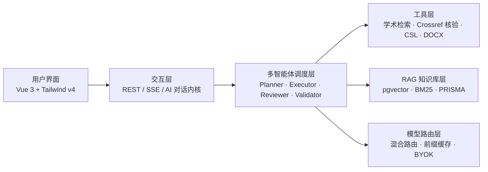

<div align="center">
  
  <h1>VeriPaper</h1>
  <p><strong>Evidence-Led Multi-Agent Literature Review Workspace</strong></p>
  <p>面向严肃研究的证据驱动型多智能体文献综述工作台 —— 让每一句综述，皆有出处。</p>

  <p>
    <a href="https://veripaper.me" target="_blank">
      
    </a>
    <a href="https://github.com/sakura-del/Multi-agent-collaborative-automation-task-assistant/actions/workflows/ci.yml">
      
    </a>
    
    
    
  </p>

  <p>
    <a href="https://veripaper.me">在线体验</a> ·
    <a href="#核心能力">核心能力</a> ·
    <a href="#系统架构">系统架构</a> ·
    <a href="#快速开始">快速开始</a> ·
    <a href="#文档与实验复现">文档与复现</a>
  </p>
</div>

---

## 项目简介

**VeriPaper** 是一套围绕「**生成即合规、引用可核验**」设计的全栈多智能体文献综述系统。针对通用大模型在学术写作中普遍存在的**幻觉引用、流程不透明、格式难对齐**问题，系统通过 **Planner → Executor → Reviewer → Validator** 四阶段协作流水线与 **五层架构**，将多库聚合检索、PRISMA 2020 标准化筛选、结构化证据提取、Crossref / OpenAlex 引文核验以及 CSL 1.0（含 `GB/T 7714-2025`）与高校 `.docx` 模板导出贯通为端到端科研工作台。

---

## 核心能力

| 能力域 | 说明 |
| --- | --- |
| **四阶段多智能体编排** | 基于 DAG 任务调度引擎，由 **Planner / Executor / Reviewer / Validator** 协同推进，支持并行执行、断点续传、SSE 实时事件流与人工干预（HITL） |
| **多源学术检索与去重** | 聚合 `arXiv`、`PubMed`、`OpenAlex`、`Semantic Scholar` 检索，支持 DOI 规范化去重与标题语义对齐 |
| **PRISMA 2020 筛选工作台** | 标题/摘要与全文双阶段纳排决策、排除理由审计、主动学习优先级排序、实时交互漏斗与 Mermaid 流程图导出 |
| **四态引文真实性核验** | 成稿前自动通过 Crossref / OpenAlex 校验题录与 DOI，输出「已核验 / 部分匹配 / 存疑 / 未核验」四态报告并支持拦截 |
| **CSL 1.0 & Word 模板导出** | 内置 `GB/T 7714-2025`（顺序编码 / 著者-出版年）、APA、IEEE、Nature 等样式，支持上传自定义 `.csl` 与学校/期刊 `.docx` 模板导出 |
| **混合检索知识库（RAG）** | 基于 PostgreSQL 17 (`pgvector`) + BM25 混合检索 + `BAAI/bge-m3` 语义嵌入，提供私有文献库与引用库管理 |
| **BYOK 混合路由与 AI 对话** | 支持用户自带 OpenAI / DeepSeek / Qwen / GLM 等模型密钥（AES 加密存储 + 连通性探测 + 节点级混合路由），内置三形态 AI 协同会话内核 |
| **团队协作与可观测性** | 团队工作区与批注抽屉、OpenAPI / API Key 开放接口、Token 与成本分账看板、订阅配额门禁 |

---

## 系统架构



---

## 技术栈

| 分层 | 技术选型 |
| --- | --- |
| **前端工作台** | Vue 3.4 (`<script setup>` + TypeScript) · Vite 5 · Tailwind CSS v4 · shadcn-vue (Reka UI) · Pinia · motion-v · KaTeX · Mermaid |
| **后端服务** | Python 3.12 · FastAPI · SQLAlchemy 2.0 (async) · Alembic · Pydantic v2 |
| **存储与向量** | PostgreSQL 17 (`pgvector`) · Redis 7 · 对象存储 (S3 / 七牛 Kodo) |
| **引文与文档** | `citeproc-py` (CSL 1.0 / GB/T 7714-2025) · `docxtpl` (沙箱 Jinja2 校验) · `pypinyin` |
| **质量与测试** | Black · Ruff · Mypy · Pytest (90% 覆盖率) · Vitest · Playwright 双视口 E2E |

---

## 项目结构

```text
├── backend/                  # FastAPI 后端
│   ├── app/
│   │   ├── api/              # REST 路由、鉴权、限流与中间件
│   │   ├── core/             # 配置优先级、日志、加密与异常体系
│   │   ├── db/               # SQLAlchemy 2.0 ORM 与仓储层
│   │   ├── interaction/      # 用户交互、任务控制与 AI 对话内核
│   │   ├── orchestration/    # DAG 调度引擎与四阶段智能体工作流
│   │   ├── knowledge/        # 混合检索 RAG、PRISMA 筛选与引文核验
│   │   ├── tools/            # 多源学术搜索、CSL 渲染与 DOCX 模板引擎
│   │   ├── llm/              # 多模型适配器、BYOK 凭据与节点混合路由
│   │   └── billing/          # 套餐配额、Token 账本与成本分账统计
│   ├── alembic/              # 数据库迁移脚本
│   ├── evaluation/           # 120-run 评测数据集、指标与论文图表生成
│   └── tests/                # 后端自动化测试
├── frontend/                 # Vue 3 + TypeScript 前端应用
│   ├── src/views/            # 公开落地页、工作台、PRISMA 筛选、看板与设置
│   ├── src/components/       # shadcn-vue 基础件、图表、时间线与业务组件
│   └── e2e/                  # Playwright 端到端测试
├── config/                   # 模型路由与降级链配置 (default.yaml)
├── deploy/                   # 生产 Compose 编排与运维脚本
├── docs/                     # 架构 ADR、设计规范、产品路线与运行手册
└── scripts/                  # 冒烟测试、Pages 部署与工具脚本
```

---

## 快速开始

### 1. Docker Compose 一键启动（推荐）

```bash
cp .env.example .env
# 按需填写 .env 中的数据库、Redis 与 LLM API Key
docker compose up -d --build
```

启动后访问：
- 前端工作台：`http://localhost`
- API 文档：`http://localhost/docs`

### 2. 本地开发启动

**后端（FastAPI）**

```bash
cd backend
python -m venv .venv
# Windows: .venv\Scripts\activate  |  Linux/macOS: source .venv/bin/activate
pip install -e ".[dev]"
alembic upgrade head
uvicorn app.main:app --reload --port 8000
```

**前端（Vue 3 + Vite）**

```bash
cd frontend
npm ci
npm run dev
```

访问 `http://localhost:5173`（开发服务器自动将 `/api` 代理至 `http://localhost:8000`）。

### 3. 离线文献综述演示

```bash
cd backend
python -m app.cli run-literature-demo --offline --max-documents 10
```

---

## 文档与实验复现

| 文档 | 说明 |
| --- | --- |
| [开发规范 (AGENTS.md)](AGENTS.md) | 前后端工程约定、测试门禁与设计系统规则 |
| [前端设计规范](docs/superpowers/specs/2026-11-20-linear-notion-redesign.md) | 极简工作台布局、图表与 Elicit 风格落地页规范 |
| [CSL 双语策略 ADR](docs/adr/0001-csl-bilingual-strategy.md) | 标准化 CSL 1.0 引擎选型与许可合规决策 |
| [实验复现手册](docs/runbooks/experiment-reproduction.md) | 评测矩阵、指标采集与论文统计图表复现步骤 |
| [部署与运维手册](docs/runbooks/deployment.md) | Compose 部署、备份恢复与健康检查指南 |

---

<div align="center">
  <sub>Built with evidence, designed for rigorous research.</sub>
</div>
