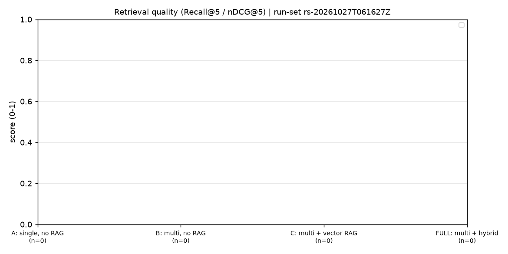
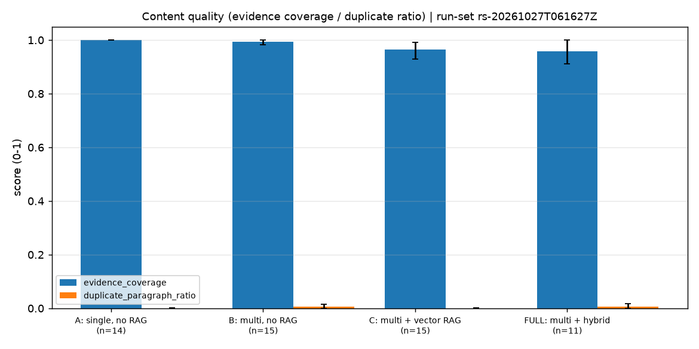
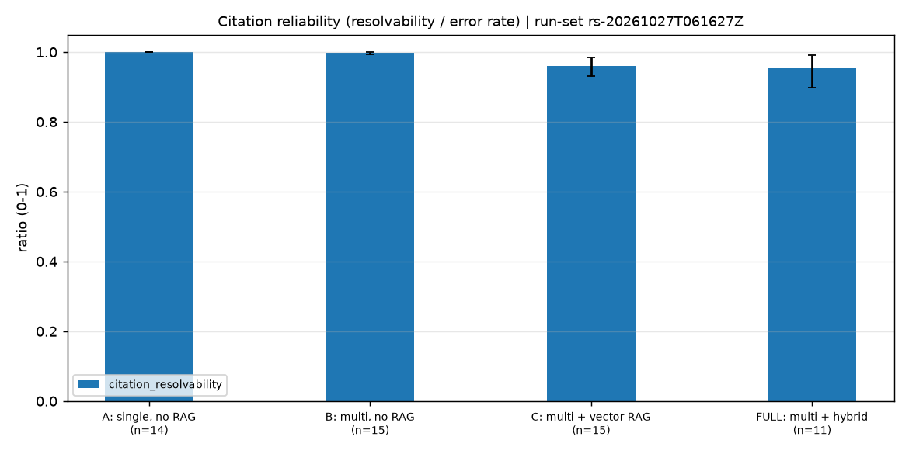
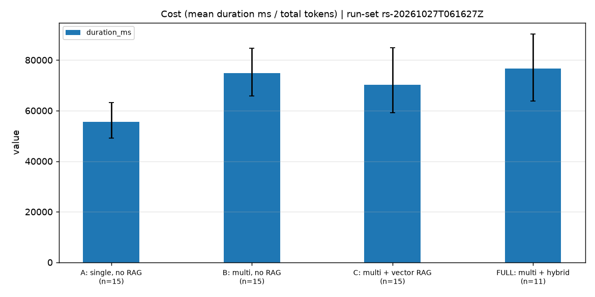
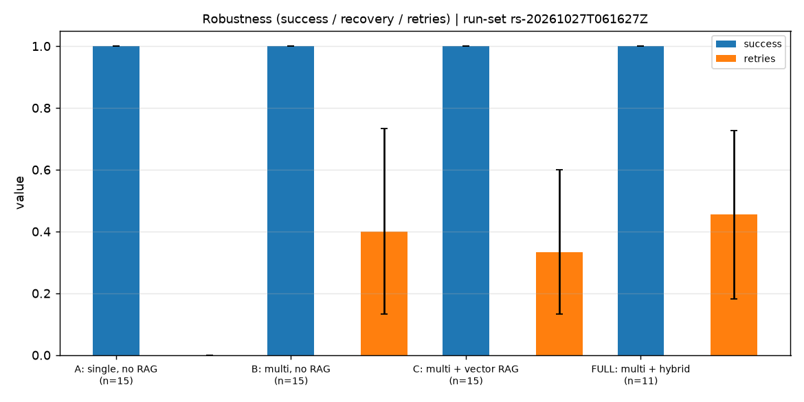

# 实验结果报告（run-set `rs-20261027T061627Z`）

- 运行总数：**60**
- 完成：**56**　失败：**0**　不完整：**0**
- 其他未完成状态：**4**（waiting_human 4）
- 指标口径：确定性指标与人工指标为主；LLM Judge 仅作补充（见文末单独章节）。

## 1. 汇总表

逐次运行明细：[`summary.csv`](summary.csv)；分组聚合（含 95% bootstrap 置信区间）：[`aggregate.csv`](aggregate.csv)；显著性检验（vs baseline A）：[`significance.csv`](significance.csv)。

| 画像 | 指标 | n | 均值 | 中位数 | 95% CI |
| --- | --- | --- | --- | --- | --- |
| A: 单 Agent 无 RAG | citation_resolvability | 14 | 1.000 | 1.000 | [1.000, 1.000] |
| A: 单 Agent 无 RAG | evidence_coverage | 14 | 1.000 | 1.000 | [1.000, 1.000] |
| A: 单 Agent 无 RAG | duplicate_paragraph_ratio | 15 | 0.000 | 0.000 | [0.000, 0.001] |
| A: 单 Agent 无 RAG | success | 15 | 1.000 | 1.000 | [1.000, 1.000] |
| A: 单 Agent 无 RAG | duration_ms | 15 | 55503.567 | 60161.366 | [49164.569, 63186.266] |
| A: 单 Agent 无 RAG | retries | 15 | 0.000 | 0.000 | [0.000, 0.000] |
| B: 多 Agent 无 RAG | citation_resolvability | 15 | 0.998 | 1.000 | [0.994, 1.000] |
| B: 多 Agent 无 RAG | evidence_coverage | 15 | 0.994 | 1.000 | [0.983, 1.000] |
| B: 多 Agent 无 RAG | duplicate_paragraph_ratio | 15 | 0.005 | 0.000 | [0.000, 0.016] |
| B: 多 Agent 无 RAG | success | 15 | 1.000 | 1.000 | [1.000, 1.000] |
| B: 多 Agent 无 RAG | duration_ms | 15 | 74871.730 | 75198.730 | [65856.112, 84571.671] |
| B: 多 Agent 无 RAG | retries | 15 | 0.400 | 0.000 | [0.133, 0.733] |
| C: 多 Agent 向量 RAG | citation_resolvability | 15 | 0.961 | 0.987 | [0.932, 0.985] |
| C: 多 Agent 向量 RAG | evidence_coverage | 15 | 0.965 | 1.000 | [0.930, 0.992] |
| C: 多 Agent 向量 RAG | duplicate_paragraph_ratio | 15 | 0.001 | 0.000 | [0.000, 0.002] |
| C: 多 Agent 向量 RAG | success | 15 | 1.000 | 1.000 | [1.000, 1.000] |
| C: 多 Agent 向量 RAG | duration_ms | 15 | 70202.469 | 65176.670 | [59159.568, 84928.822] |
| C: 多 Agent 向量 RAG | retries | 15 | 0.333 | 0.000 | [0.133, 0.600] |
| FULL: 多 Agent 混合检索+重排 | citation_resolvability | 11 | 0.954 | 1.000 | [0.898, 0.992] |
| FULL: 多 Agent 混合检索+重排 | evidence_coverage | 11 | 0.958 | 1.000 | [0.911, 1.000] |
| FULL: 多 Agent 混合检索+重排 | duplicate_paragraph_ratio | 11 | 0.006 | 0.000 | [0.000, 0.017] |
| FULL: 多 Agent 混合检索+重排 | success | 11 | 1.000 | 1.000 | [1.000, 1.000] |
| FULL: 多 Agent 混合检索+重排 | duration_ms | 11 | 76589.644 | 75249.566 | [63834.978, 90269.128] |
| FULL: 多 Agent 混合检索+重排 | retries | 11 | 0.455 | 0.000 | [0.182, 0.727] |

## 2. 图表

每张图都带标题、样本量与置信区间误差线。

### 检索质量（Recall@5 / nDCG@5）



指标：recall_at_5, ndcg_at_5。数据来源：`aggregate.csv`（run-set `rs-20261027T061627Z`）。

### 内容质量（证据覆盖 / 重复段落比）



指标：evidence_coverage, duplicate_paragraph_ratio。数据来源：`aggregate.csv`（run-set `rs-20261027T061627Z`）。

### 引用可靠性（可解析率 / 错误引用率）



指标：citation_resolvability, error_citation_rate。数据来源：`aggregate.csv`（run-set `rs-20261027T061627Z`）。

### 执行成本（平均耗时 / 总 token）



指标：duration_ms, total_tokens。数据来源：`aggregate.csv`（run-set `rs-20261027T061627Z`）。

### 鲁棒性（成功率 / 恢复成功率 / 重试次数）



指标：success, recovery_success, retries。数据来源：`aggregate.csv`（run-set `rs-20261027T061627Z`）。

## 3. 显著性检验

配对 Wilcoxon 秩和检验，配对键为 (课题, 重复次数)；样本不足或差值全零时记为 —，不编造 p 值。

| 画像 | 指标 | 配对数 | 统计量 | p 值 |
| --- | --- | --- | --- | --- |
| B: 多 Agent 无 RAG | citation_resolvability | 14 | 0.000 | 0.1797 |
| B: 多 Agent 无 RAG | evidence_coverage | 14 | 0.000 | 0.3173 |
| B: 多 Agent 无 RAG | duplicate_paragraph_ratio | 15 | 1.000 | 0.2850 |
| B: 多 Agent 无 RAG | duration_ms | 15 | 14.000 | 0.0067 |
| B: 多 Agent 无 RAG | retries | 15 | 0.000 | 0.0339 |
| C: 多 Agent 向量 RAG | citation_resolvability | 14 | 0.000 | 0.0077 |
| C: 多 Agent 向量 RAG | evidence_coverage | 14 | 0.000 | 0.0656 |
| C: 多 Agent 向量 RAG | duplicate_paragraph_ratio | 15 | 1.000 | 0.6547 |
| C: 多 Agent 向量 RAG | duration_ms | 15 | 16.000 | 0.0103 |
| C: 多 Agent 向量 RAG | retries | 15 | 0.000 | 0.0253 |
| FULL: 多 Agent 混合检索+重排 | citation_resolvability | 10 | 0.000 | 0.1250 |
| FULL: 多 Agent 混合检索+重排 | evidence_coverage | 10 | 0.000 | 0.5000 |
| FULL: 多 Agent 混合检索+重排 | duplicate_paragraph_ratio | 11 | 1.000 | 1.0000 |
| FULL: 多 Agent 混合检索+重排 | duration_ms | 11 | 8.000 | 0.0244 |
| FULL: 多 Agent 混合检索+重排 | retries | 11 | 0.000 | 0.0625 |

## 4. 缺失与失败运行

以下运行**未计入聚合**，但保留在案以便复核：

- `multi_agent_hybrid_rerank:ai-rag-eval:1` — waiting_human（未完成，未计入聚合）
- `multi_agent_hybrid_rerank:edu-adaptive:1` — waiting_human（未完成，未计入聚合）
- `multi_agent_hybrid_rerank:se-defect-pred:1` — waiting_human（未完成，未计入聚合）
- `multi_agent_hybrid_rerank:se-test-gen:1` — waiting_human（未完成，未计入聚合）

> ⚠️ **统计口径提醒**：聚合表与显著性检验**只统计 completed 的运行**（本次 56/60）。若未完成的运行在某个画像里集中出现，该画像的指标存在**幸存者偏差**，解读时必须以「completed 数 / 总数」作为真实成功率，不能只看 `success` 均值。

## 5. LLM Judge（补充指标，不并入主质量分）

LLM Judge 得分仅用于**补充**观察，需在论文中标注所用模型、版本与 Prompt 版本，且不得与确定性/人工指标平均成单一主质量分。本节数据需单独运行 Judge 脚本后填入。

| 项目 | 值 |
| --- | --- |
| 模型 / 版本 | 待填写 |
| Prompt 版本 | 待填写 |
| 说明 | 仅作补充，不参与主指标计算 |

## 6. 复现方式

```bash
cd backend
python -m evaluation.cli validate
python -m evaluation.cli run --profiles all --repetitions 2
python -m evaluation.cli report --run-set <run-set-id>
```

本报告由 `evaluation/reporting.py` 从 run-set `rs-20261027T061627Z` 自动生成，bootstrap 与检验均使用固定 seed，同输入两次生成结果一致。

---

> **本文件的生成方式（重要，勿删）**
>
> 表格、失败清单与统计口径提醒由 `evaluation/reporting.py` 渲染，输入是**真实的**
> `summary.csv`（60 行状态）/ `aggregate.csv` / `significance.csv`（run-set
> `rs-20261027T061627Z`）。
>
> **不是**由工具重新扫描 run-set 目录生成的 —— 因为生成时服务器不可达，
> 且 run-set 产物在容器内无挂载卷。等服务器恢复后应重跑
> `python -m evaluation.cli report --run-set rs-20261027T061627Z` 覆盖本文件。
>
> 图表由本地 matplotlib 3.11.2 从同一份真实 `aggregate.csv` 渲染。
> `retrieval.png` 是**空图**（四个画像 n=0），因为检索指标未被 live 执行器记录
> —— 见 `docs/superpowers/plans/2026-10-27-04-experiment-matrix-60runs-plan.md` §7。
