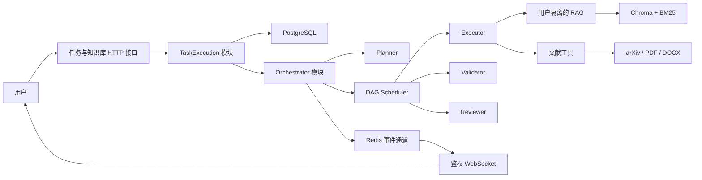

# 自动化文献综述答辩主线设计规格

**日期：** 2026-08-09  
**状态：** 已确认，待用户审阅文件  
**项目：** 多智能体协作自动化任务助手

## 1. 目标

在 10 周内将当前模块级原型收敛为一套可用于毕业设计答辩和论文实验的自动化文献综述系统。系统必须形成以下完整闭环：

```text
用户提交课题
  -> Planner 生成研究计划和 DAG
  -> 用户确认计划
  -> Scheduler 调度 Executor
  -> RAG 和文献工具提供证据
  -> Validator 校验节点结果
  -> Reviewer 生成综述和质量报告
  -> 前端展示过程并导出 Markdown/DOCX
```

首要验收标准是闭环可运行、引用可追溯、任务可恢复、用户数据隔离、答辩现场稳定以及论文实验可重复。通用平台能力和多业务场景不属于首版目标。

## 2. 当前基线

仓库已经具备 FastAPI、JWT 鉴权、PostgreSQL ORM、Redis、LLM adapter、四类 Agent、DAG/Scheduler 和 RAG 模块，并有相应的模块级测试。

当前仍存在以下关键缺口：

- FastAPI 只挂载健康检查、鉴权、WebSocket 回显和知识库接口，没有任务提交与编排入口。
- Agent、DAG、Scheduler、LLM 和 RAG 尚未接入一条生产执行链路。
- 编排状态、能力注册和恢复逻辑主要停留在内存或序列化示例，未以 PostgreSQL 为事实来源。
- 知识库接口缺少用户鉴权和所有权隔离，并接受服务端文件路径。
- WebSocket 尚未鉴权，也未连接任务事件。
- 前端仍是阶段 0 的登录联调页面。
- Docker Compose 不负责前端构建和数据库迁移，后端镜像依赖与已挂载功能不一致。
- CI 不验证前端、Compose 启动和完整任务闭环。
- `checklist.md`、`dev-plan-v2.md` 与实际提交状态存在明显漂移。

因此，后续开发不按原阶段继续横向增加工具和场景，而是以单场景纵向闭环重新排序。

## 3. 范围

### 3.1 必须实现

- 用户注册、登录、令牌刷新和资源隔离。
- PDF、DOCX、Markdown、TXT 文献上传、列表、删除和索引状态查询。
- 文献综述任务创建，参数包括研究主题、关键词、时间范围、文献数量、输出语言和引用格式。
- Planner 生成结构化研究计划、子主题、检索词、验收条件和 DAG。
- 用户确认规划后才进入执行。
- Executor 检索文献、提取证据并按子主题生成章节。
- Validator 检查引用、结构、完整性、重复内容和一致性。
- Reviewer 生成最终综述、质量报告、失败归因和执行统计。
- 任务暂停、恢复、终止、补充输入和失败节点重跑。
- 前端任务列表、规划确认、DAG、日志、人工处理、结果和下载。
- Markdown 与 DOCX 导出。
- 固定离线演示文献集，以及作为增强能力的 arXiv 在线检索。
- 单 Agent、多 Agent、纯向量 RAG、完整混合 RAG 四组论文实验。

### 3.2 明确不实现

- 代码生成和电商文案业务场景。
- Google Scholar 和知网爬虫。
- Java、C++ 或任意系统命令代码沙箱。
- 可视化工作流编辑器和任意 Agent 编排。
- LoRA 微调和 200 条人工标注训练集。
- 多节点分布式调度、动态扩缩容和复杂租户管理。
- 多模型切换管理界面。
- 通用插件市场或完整工具生态。

代码生成和电商文案只在论文与答辩中作为架构扩展方向说明，不进入首版实现和验收。

## 4. 目标架构

系统保留现有 FastAPI、PostgreSQL、Redis、Chroma、四类 Agent 和 DAG 模块。答辩版本采用单后端实例，不引入 Celery、Kafka 或微服务。



架构约束：

- `TaskExecution` 是对路由暴露的深模块，隐藏 Agent 初始化、DAG 调度、状态转换、检查点、重试和恢复实现。
- PostgreSQL 是任务状态的唯一事实来源。
- Redis 只用于实时事件、短期缓存和连接广播，不保存不可丢失的任务状态。
- Chroma 和 BM25 保存按用户隔离的知识索引。
- HTTP 提交任务后立即返回任务 ID，实际执行进入后台协程。
- 应用启动时从 PostgreSQL 恢复未完成任务。
- 当前版本只保证单后端实例运行；分布式执行明确留作后续工作。

## 5. 模块接口

### 5.1 TaskExecution

外部接口限制为：

```text
submit(user_id, request) -> task_id
approve_plan(user_id, task_id, revision) -> task_snapshot
control(user_id, task_id, command) -> task_snapshot
get_snapshot(user_id, task_id) -> task_snapshot
subscribe(user_id, task_id, after_event_id) -> task_events
```

HTTP 路由只能调用该接口，不直接创建 Agent、访问 Scheduler 或修改任务状态。

### 5.2 Agent 契约

| 模块 | 输入 | 输出 | 职责 |
|---|---|---|---|
| Planner | 课题、约束、可用文献 | `TaskPlan` | 子主题、检索词、DAG、验收条件 |
| Scheduler | 已确认的 `TaskPlan` | 调度事件 | 依赖解析、并行控制、重试、检查点 |
| Executor | `SubtaskSpec`、RAG 上下文 | `ExecutionResult` | 文献检索、信息提取、章节生成 |
| Validator | 节点结果、验收条件 | `ValidationReport` | 引用、结构、完整性和一致性检查 |
| Reviewer | 全部结果与日志 | `ReviewReport` | 综合评分、问题归因、最终综述 |
| Knowledge | `user_id`、查询或文档 | 检索结果 | 用户隔离、分块、混合检索、重排 |
| LiteratureTools | 结构化工具参数 | 结构化结果 | arXiv、解析、Markdown/DOCX 导出 |
| EventPublisher | `TaskEvent` | 事件编号 | Redis 发布和断线补偿 |

接口约束：

- Planner 必须返回经过 Pydantic 校验的结构化 `TaskPlan`。
- Executor 的每条正式论述必须携带 `doc_id`、`chunk_id` 或来源 URL。
- 没有证据支持的内容必须标记为模型推断，不能作为文献事实输出。
- Validator 先执行确定性规则，再执行 LLM 语义检查。
- Reviewer 只消费已持久化结果，不重新调用工具。
- 文献工具只接受结构化参数和受控文件标识。
- PostgreSQL、Redis、Chroma 和 arXiv 分别通过明确 seam 接入，并提供生产 adapter 与内存测试 adapter。

## 6. 数据流与状态机

### 6.1 数据流

1. `POST /tasks` 校验用户和任务参数，创建任务记录。
2. Planner 生成子主题、检索计划和 DAG。
3. 系统在同一事务中保存 `TASK`、`SUBTASK` 和 `TASK_DAG`。
4. 任务进入 `WAITING_APPROVAL`，等待用户确认。
5. 用户确认后，Scheduler 按依赖关系释放可执行节点。
6. 节点执行前保存输入与尝试次数，执行后保存输出、证据、耗时和模型信息。
7. Validator 持久化结构化校验结果。
8. Reviewer 汇总全部结果，生成综述和质量报告。
9. 数据库事务提交后发布 Redis 事件。
10. 前端断线重连时先读取数据库快照，再补拉遗漏事件。

### 6.2 任务状态

```text
CREATED
  -> PLANNING
  -> WAITING_APPROVAL
  -> RUNNING
  -> REVIEWING
  -> COMPLETED
```

允许的分支：

```text
任意活动状态 -> PAUSED -> 原状态
任意活动状态 -> CANCELLED
可恢复错误   -> RETRYING -> RUNNING
重试耗尽     -> WAITING_HUMAN -> RUNNING / FAILED
不可恢复错误 -> FAILED
```

### 6.3 子任务状态

```text
PENDING -> READY -> RUNNING -> VALIDATING -> COMPLETED
                         |
                         -> RETRYING -> READY
                         -> WAITING_HUMAN
                         -> FAILED
```

### 6.4 持久化原则

- 复用现有 `TASK`、`SUBTASK`、`TASK_DAG`、`EXECUTION_LOG`、`VALIDATION_RESULT`、`HUMAN_FEEDBACK` 和 `FAILURE_CASE` 表。
- 每次状态转换与日志记录在同一数据库事务内完成。
- 节点执行使用 `task_id + subtask_id + attempt` 作为幂等标识。
- 已完成节点不重复执行，重启后只重新调度未完成节点。
- 最终结果、质量报告和导出文件都绑定 `task_id` 与 `user_id`。
- 现有内存状态机可以作为执行期缓存，但不能作为最终状态来源。

## 7. HTTP 与实时接口

```text
POST   /api/v1/tasks
GET    /api/v1/tasks
GET    /api/v1/tasks/{task_id}
POST   /api/v1/tasks/{task_id}/plan/approve
POST   /api/v1/tasks/{task_id}/control
GET    /api/v1/tasks/{task_id}/events
POST   /api/v1/ws-ticket
WS     /api/v1/tasks/{task_id}/ws

POST   /api/v1/knowledge/documents
GET    /api/v1/knowledge/documents
DELETE /api/v1/knowledge/documents/{doc_id}
GET    /api/v1/knowledge/stats
```

接口规则：

- 所有任务和知识库接口都要求鉴权。
- 资源在查询阶段按 `user_id` 过滤，越权与不存在统一返回 404。
- WebSocket 使用短期、单次连接票据，不传递长期 access token。
- WebSocket 事件包含递增 `event_id`。
- 重连先读取任务快照，再读取最后一个 `event_id` 之后的事件。
- 连续重连失败后，前端降级为每 3 秒轮询。

## 8. 异常恢复

| 失败类型 | 处理策略 |
|---|---|
| LLM 超时、限流、临时网络错误 | `1s -> 3s -> 9s` 退避，最多 3 次；只有配置备用模型时才切换 |
| LLM 输出不符合 Schema | 携带校验错误修复一次，再失败则进入人工处理 |
| 检索结果不足 | 扩展检索词并重试一次，仍不足则报告证据不足 |
| PDF 损坏或无法解析 | 跳过单篇并记录原因，有效文献低于阈值时暂停任务 |
| 节点校验失败 | 只重做失败节点，最多 2 次 |
| 数据库、权限、路径和状态冲突 | 不自动重试，立即停止并保留检查点 |
| Redis 或 WebSocket 故障 | 任务继续执行，前端切换为 HTTP 轮询 |
| arXiv 不可用 | 使用预置离线文献集 |

人工处理只提供重新执行节点、补充输入后执行和终止任务三种动作。首版不允许跳过必需节点。

暂停和取消在节点边界生效。已经提交给模型的单次请求可以完成，但结果在状态不允许写入时必须丢弃。

## 9. 安全设计

- 所有任务、文档、日志和导出文件在数据库查询阶段按 `user_id` 过滤。
- 上传采用 multipart 文件流，由服务端生成随机文件名并写入受控目录。
- 禁止客户端提交服务端路径。
- 校验文件扩展名、MIME、文件签名、单文件大小和任务总容量。
- 上传目录不通过 Nginx 直接公开。
- 文献内容视为不可信数据，不能改变系统 Prompt、工具权限或执行规则。
- 工具使用固定白名单、参数 Schema、超时和输出大小限制。
- 系统不存在任意命令执行入口。
- 日志记录 `trace_id/task_id/subtask_id/agent_id/attempt`，但不记录密钥、令牌、密码或完整文献正文。
- 导出时转义 HTML 和文件名，外部引用链接只允许 `http/https`。
- 错误响应返回结构化错误码、用户说明、是否可重试和建议操作，不返回 Python 堆栈。

## 10. 前端工作台

首屏进入任务工作台，不建设营销首页。

| 页面 | 主要功能 |
|---|---|
| `/login` | 登录、注册、令牌刷新 |
| `/tasks` | 任务列表、筛选、新建综述任务 |
| `/tasks/:id` | 规划确认、DAG、日志、人工处理、结果 |
| `/knowledge` | 文献上传、索引状态、删除、检索测试 |

任务详情包含四个页签：

- 规划：子主题、关键词、文献范围和 DAG，支持重新规划或确认执行。
- 执行：DAG、总体进度、当前节点、耗时、重试次数和节点详情。
- 日志：按 Agent、节点和级别筛选结构化事件。
- 结果：最终综述、参考文献、质量报告和下载。

人工操作随状态变化：

```text
RUNNING       -> 暂停 / 终止
PAUSED        -> 恢复 / 终止
WAITING_HUMAN -> 补充输入 / 重跑节点 / 终止
COMPLETED     -> 查看结果 / 下载
FAILED        -> 查看原因 / 从检查点重试
```

前端刷新不能丢失任务状态。令牌过期时自动轮换 refresh token，轮换失败才回到登录页。

DAG 可视化允许引入一个成熟的 Vue 图展示依赖，但只使用查看和节点选择能力，不开发流程编辑器。

## 11. 工程测试

### 11.1 单元测试

覆盖结构化规划、DAG 校验、状态转换、重试、用户隔离、引用校验、文献解析和导出。模型与外部系统使用确定性 adapter。

### 11.2 集成测试

使用真实 PostgreSQL、Redis 和 Chroma，验证鉴权、任务持久化、知识库隔离、节点检查点、服务重启恢复和 WebSocket 事件补偿。

### 11.3 端到端测试

使用固定 LLM 输出完成以下流程，普通 CI 不依赖外网和真实模型：

```text
登录 -> 上传文献 -> 创建任务 -> 确认规划 -> 执行 -> 校验 -> 导出
```

### 11.4 真实模型验收

使用固定离线文献集和固定模型参数运行完整流程，记录模型版本、Prompt 版本、数据版本、Token、耗时和结果。真实模型验收不放入普通 CI。

### 11.5 CI 门禁

- 后端 Black、Ruff、Mypy 阻断合并。
- 后端覆盖率不低于 80%。
- 前端执行类型检查、构建和关键交互测试。
- 执行越权、恶意路径、非法文件和断线重连测试。
- Docker 镜像构建后执行迁移、健康检查和 Compose smoke test。
- 合入主分支前通过一条固定数据集端到端用例。

## 12. 论文实验

### 12.1 实验组

| 实验组 | Agent | RAG | 校验与复盘 |
|---|---|---|---|
| 基线 A | 单 Agent | 无 | 无 |
| 基线 B | 多 Agent | 无 | 有 |
| 基线 C | 多 Agent | 纯向量检索 | 有 |
| 完整方案 | 多 Agent | 向量 + BM25 + 重排 | 有 |

实验至少使用 15 个研究课题，覆盖 3 个领域，每组运行 2 次。所有实验固定模型、温度、Prompt 和文献集版本。

### 12.2 评价指标

- 检索：Recall@5、MRR、nDCG@5。
- 引用：引用可解析率、证据覆盖率、错误引用率。
- 内容：结构完整性、重复率、事实一致性、主题覆盖度。
- 系统：任务成功率、平均耗时、Token 消耗、重试次数、恢复成功率。
- 人工评价：准确性、连贯性、完整性、引用质量，采用匿名五分制。
- LLM Judge 只作为补充指标，不作为唯一质量证据。

实验必须保留原始输入、配置、运行日志、结构化指标和生成结果，确保论文结果可复查。

## 13. 十周路线

| 周次 | 开发重点 | 验收结果 |
|---|---|---|
| 第 1 周 | 安全与运行基线 | 知识库鉴权和隔离；移除路径读取；补齐依赖、迁移、前端构建和 readiness |
| 第 2 周 | 任务接口与持久化 | 任务创建、查询、规划确认、控制；状态写入 PostgreSQL |
| 第 3 周 | 执行运行时 | `TaskExecution` 接通 Planner、DAG、Scheduler；固定 adapter 端到端通过 |
| 第 4 周 | Agent 完整闭环 | Executor、Validator、Reviewer、RAG 接通；重试、检查点和恢复通过 |
| 第 5 周 | 文献综述工具 | 受控上传、arXiv、解析、证据映射和导出 |
| 第 6 周 | 前端任务工作台 | 任务、规划、DAG、日志、人工处理、结果和下载可用 |
| 第 7 周 | 稳定性与安全 | 重连、轮询、离线数据、故障注入、越权测试和 Compose smoke test |
| 第 8 周 | 论文基线实验 | 四组实验可重复执行 |
| 第 9 周 | 数据分析与优化 | 生成质量、检索、耗时、Token 和恢复指标图表 |
| 第 10 周 | 答辩冻结 | 冻结功能、部署文档、演示脚本、论文素材和两次模拟答辩 |

### 13.1 里程碑

- M1，第 1 周末：安全且可部署的基础版本。
- M2，第 3 周末：通过 HTTP 接口完成固定模型任务闭环。
- M3，第 5 周末：真实文献生成带可追溯引用的综述。
- M4，第 6 周末：不依赖 Swagger 或终端完成整场操作。
- M5，第 7 周末：形成答辩候选版本并停止新增产品功能。
- M6，第 9 周末：论文实验数据与图表齐全。
- M7，第 10 周末：发布答辩冻结版本。

### 13.2 执行规则

- P0 安全问题、Docker 运行链路和数据库迁移完成前，不开发新业务功能。
- M2 未通过前，不开发前端 DAG 和创新功能。
- M3 未通过前，不开展大规模论文实验。
- 第 7 周后只允许修复缺陷、优化已有指标和完善答辩材料。
- 任一周延期时，依次删除多模型降级、在线 arXiv、复杂质量评分和非必要动画。
- 用户隔离、检查点恢复、离线演示和引用追溯不得删除。
- `checklist.md` 改为“已实现、已测试、已集成、已验收”四态。

## 14. 验收标准

- 两个用户之间无法读取对方任务、文献、日志和导出文件。
- 服务重启后能够从最后完成节点继续执行。
- WebSocket 中断不影响任务执行，并能恢复遗漏事件。
- 离线演示数据集可在 5 至 10 分钟内生成可下载综述。
- 所有正式引用都能回溯到原始文献或检索记录。
- 固定 adapter 端到端测试在 CI 中稳定通过。
- 真实模型验收记录模型、Prompt、数据、Token、耗时和结果版本。
- 前后端、数据库迁移、Nginx、WebSocket 和知识库可通过 Compose smoke test。
- 答辩候选版本不存在未解决的 P0 或 P1 缺陷。

## 15. 风险与约束

- 在线 arXiv 和真实模型可能受网络、限流和供应商状态影响，因此答辩必须使用固定离线文献集并保留在线增强能力。
- 真实模型输出存在随机性，工程 CI 使用确定性 adapter，论文实验固定参数并重复运行。
- PDF 解析质量受扫描件和复杂排版影响，首版只保证文本型 PDF；无法解析的文献必须明确报告。
- 单实例后台协程不支持水平扩展。本限制不影响答辩目标，但必须在论文中明确。
- 人工评价成本较高，实验范围固定为至少 15 个课题、3 个领域和每组 2 次，避免无限扩张。
- 第 7 周后不增加场景、工具或工作流编辑能力，以保护答辩版本稳定性。
